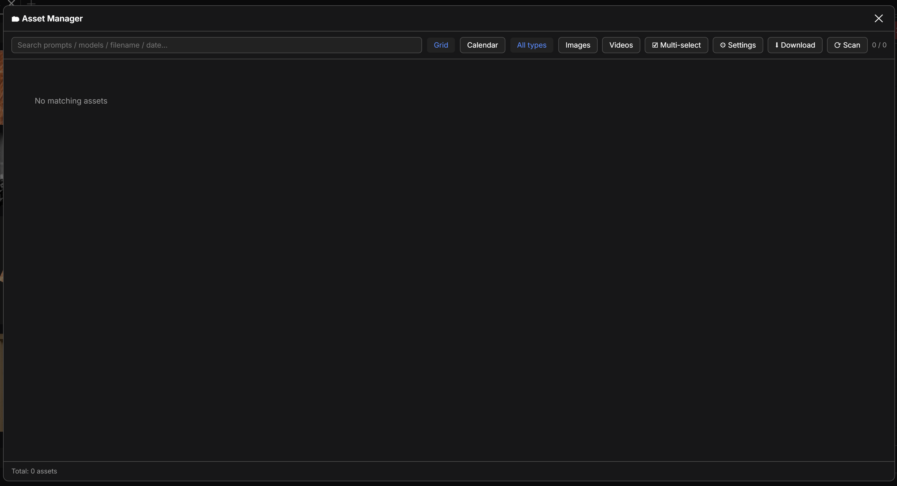
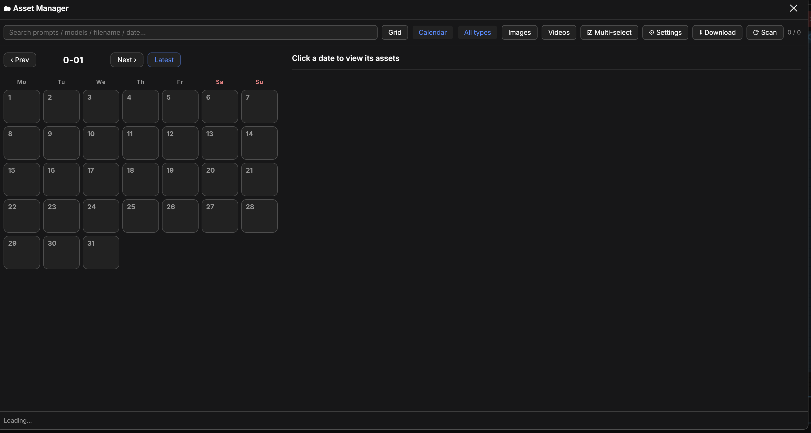

# ComfyUI-AssetManager

An in-panel **asset manager** for ComfyUI that auto-archives every image/video you generate — browse, search, batch-delete, and one-click backup.

集成进 ComfyUI 网页的**资产管理面板**，自动归档你跑出的每一张图/视频，随取随用、可搜索、可批量删除、可一键备份。

## ✨ Features · 功能亮点

- **Auto-archive** — a background thread watches the output directory and archives every asset instantly (on first run it also imports the assets already in the output directory), extracting **prompt / positive-negative / params (seed, steps, sampler…) / models & LoRA / full workflow** metadata (reads PNG/WebP embedded metadata and MP4/WebM ffmpeg metadata).<br>
  **自动归档** — 后台线程自动监视输出目录，新产物即时入库（首次运行也会归档 output 目录里已有的产物），并提取**提示词 / 正负词 / 参数(seed/steps/采样器…) / 模型与 LoRA / 完整工作流**元数据（读 PNG/WebP 内嵌元数据、MP4/WebM 的 ffmpeg 元数据）。
- **Three views** — grid view + **calendar view** (grouped by date, with daily image/video count badges; click a day to see that day's assets) + **folder view** (see below).<br>
  **三视图浏览** — 网格视图 + **日历视图**（按日期归档，每天显示图/视频数量徽标，点某天看当天产物）+ **文件夹视图**（见下）。
- **Folder view** — a third view, side by side with grid and calendar, that browses your output directory as a **folder tree in the left panel** while the **right panel stays a pure image grid** (no buttons eating into your viewing area): **create / rename / delete** folders in place (deleting a non-empty folder asks for confirmation first), click any folder in the tree — or just press `↑` / `↓` — and the right panel switches to that folder's images immediately. A clickable breadcrumb replaces the old "up" button, so jumping to any parent takes one click. The left and right panels **scroll independently**, so reading the tree never drags the images with it; a `根` (Root) row sits at the top of the tree, and long folder names **wrap** instead of being cut off.<br>
  **文件夹视图** — 与网格、日历并列的第三个视图：**左栏是文件夹树**，**右栏保持纯图片网格**（不再被按钮挤占看图区域）。可就地**新建 / 改名 / 删除**文件夹（删非空会先二次确认）；点树中任一文件夹、或直接按 `↑` / `↓`，右侧**立刻**切到该文件夹的图片；可点面包屑取代原来的「上级」按钮，回任一层都只要一次点击。**左右两栏各自独立滚动**，翻树不会把图片一起带走；树顶有 `根` 行，文件夹名过长会**自动换行**而不是被截断。
- **Folder preview pages like the other views · 文件夹视图也能翻页** — opening an image inside the folder view gives you the same `←` / `→` (and on-screen arrows) paging as the grid and calendar: wraps around, shows `n / total`, preloads neighbours, `Esc` closes.<br>
  **文件夹视图也能翻页** —— 在文件夹视图里点开图片，和网格/日历一样能用 `←` / `→`（或屏幕箭头）翻页：循环切换、显示 `n / 总数`、相邻预加载、`Esc` 关闭。
- **Multi-select folders and download them · 多选文件夹并下载** — one multi-select mode with **mutually exclusive selection types**: tick files and the folder ticks clear, tick folders and the file ticks clear, and both show a visible `✓`. Select folders and press `下载` to download **everything inside them, sub-folders included** (or tick files to download just those). `删除` removes the ticked folders (one combined confirmation lists the file counts), or the current folder when nothing is ticked; `剪切` / `粘贴` stay file-only, and `改名` always acts on the current folder.<br>
  **多选文件夹并下载** —— 一套多选模式，**两种选中类型互斥**：勾了文件就清掉文件夹勾选，勾了文件夹就清掉文件勾选，两类都有可见的 `✓`。勾选文件夹后点 `下载` 会把**文件夹里的东西全部下下来（含子目录）**；只勾文件就只下这些文件。`删除` 会删掉勾选的文件夹（一次性确认框里列出各自文件数），没勾选时删当前文件夹；`剪切`/`粘贴` 始终只对文件，`改名` 始终作用于当前文件夹。
- **Cut & paste to move assets** — tick assets in the right panel, press `剪切`, open the target folder, press `粘贴`. The asset moves as **one whole entry**: the file on disk, the archive entry's source path and the archive state are rewritten together, so preview / delete / download keep working and the moved file is never archived a second time.<br>
  **剪切粘贴搬资产** — 在右栏勾选资产 → `剪切` → 打开目标文件夹 → `粘贴`；资产按**整条目**搬移：磁盘文件、归档条目的来源路径、归档状态一并改写，预览/删除/下载照旧可用，也不会被当成新产物重复归档。
- **Unified sorting** — a single Sort dropdown shared by every view: **created time** ↓/↑, **last-opened time** ↓/↑, **name** A→Z / Z→A; the default is **newest created first**. "Last opened" is tracked by the plugin (the last time you previewed / opened that item in the panel).<br>
  **统一排序** — 一个「排序」下拉作用于所有视图：**新建时间** ↓/↑、**打开时间** ↓/↑、**名称** A→Z / Z→A，**默认最近新建的排在前面**。「打开时间」由插件记录（你在面板里最后一次预览/打开它的时间）。
- **Search & filter** — full-text search by prompt/model/filename/date; filter by image/video.<br>
  **搜索与过滤** — 按提示词/模型/文件名/日期全文搜索，按图片/视频过滤。
- **Preview & reproduce** — view full-size images / play videos, copy prompt, download `workflow.json` (drag it back onto the canvas to restore the whole workflow).<br>
  **预览与复现** — 点开看大图/播视频、复制提示词、下载 workflow.json（拖回画布还原整套工作流）。
- **Preview navigation** — inside the large-image preview press `←` / `→` (or the on-screen arrows) to flip through the current batch without closing it; wraps around, shows `n / total`, `Esc` closes, adjacent images are preloaded. The preview dialog is now as tall as the main panel and ~30% wider; the arrows sit outside the image, close to the panel edges.<br>
  **大图翻页** — 大图预览里按 `←` / `→`（或屏幕左右箭头）直接翻当前这批图，不用关掉再点下一张；循环切换、显示 `n / 总数`、`Esc` 关闭、相邻图预加载。预览面板现在与主面板同高、宽约 +30%，箭头在图片外、贴着面板边缘。
- **Batch delete** — multi-select and delete from disk in one click (archive copy + original output file); single delete too.<br>
  **批量删除** — 多选勾选后一键从硬盘删除（归档副本 + output 原始文件），单个删除也可。
- **Clean downloads** — the ⬇ Download button only saves the images/videos themselves, flattened into one folder/ZIP (no `workflow.json` / `info.json` / `prompt.txt`, thumbnails are never downloaded, no per-asset folders). Two settings switch the metadata and the folder layout back on.<br>
  **干净下载** — 点「⬇ 下载」默认只保存图片/视频本体，全部平铺在一个文件夹/ZIP 里（不带 `workflow.json` / `info.json` / `prompt.txt`，缩略图始终不下载，不建每张图的文件夹）；设置里两个开关可把元数据和文件夹结构打开。
- **Range select** — in multi-select mode hold `Shift` and click another card to select everything in between (works in grid and calendar-day lists; `Shift`-click also switches multi-select on).<br>
  **连选一段** — 多选模式下按住 `Shift` 再点另一张，两次点击之间的图全部选中（网格与日历当天列表都生效；未开多选时 `Shift`+点击会自动进入多选）。
- **Live refresh** — the panel auto-syncs every 8 seconds; files manually copied into the output directory get archived, and manual deletions disappear automatically.<br>
  **实时刷新** — 面板每 8 秒自动同步，手动复制进输出目录的文件也会被归档、手动删除也会自动消失。
- **Output directory switching** — change the output directory in settings; new assets save there instantly and it's **restored automatically after ComfyUI restarts**.<br>
  **输出目录切换** — 设置里改输出目录，新产物即时改存；**重启 ComfyUI 后自动恢复**。
- **Directory picker** — the output/archive/backup fields each have a "Browse…" button; pick a folder with the mouse, no manual path typing.<br>
  **目录点选** — 输出/归档/备份三个目录都带「浏览…」按钮，鼠标点选目录，无需手输路径。
- **One-click backup** — package "asset library + workflows + plugin config" into a zip.<br>
  **一键备份** — 把「资产库 + 工作流 + 插件配置」打包成 zip。

### Differentiators · 差异化

- Calendar browsing by date (most similar plugins only have a grid list)<br>
  日历按日期归档浏览（多数同类插件只有网格列表）
- Folder management (create / rename / delete) plus cut-&-paste asset moving **inside the output tree, with the archive relinked** — move a file and its archive entry, prompt, params, workflow and thumbnail all stay attached. The whole folder tree lives in the left panel and is walkable with `↑` / `↓`, so you never have to click "up" over and over.<br>
  文件夹管理（新建/改名/删除）+ 剪切粘贴搬移，**搬运时归档跟着 relink** —— 移动文件后它的归档条目、提示词、参数、工作流、缩略图全都还挂着，不会脱节。整棵文件夹树就在左栏，可用 `↑` / `↓` 逐级走，不必反复点「上级」。
- Batch delete + live scan refresh (manual drag-in/delete also syncs)<br>
  批量删除 + 实时扫描刷新（手动拖入/删除文件也会同步）
- Output directory switching, auto-restored after restart<br>
  输出目录切换且重启自动恢复
- Directory picker — no absolute path typing required<br>
  目录浏览器点选，不依赖手输绝对路径

## 📸 Screenshots · 界面预览

| Grid · 网格视图 | Calendar · 日历视图 |
|---|---|
|  |  |

| Preview · 预览详情 | Settings · 资产设置 | Browse · 目录点选 |
|---|---|---|
|  |  |  |

## 📦 Installation · 安装

### Method 1: ComfyUI-Manager (recommended) · 方法一：ComfyUI-Manager（推荐）

Search for `AssetManager` in the Manager and install.<br>
在 Manager 里搜索 `AssetManager` 安装。

### Method 2: git clone · 方法二：git clone

```bash
cd ComfyUI/custom_nodes
git clone https://github.com/wardenlee/ComfyUI-AssetManager.git
```

### Method 3: Manual download · 方法三：手动下载

Download the repo zip and extract it into `ComfyUI/custom_nodes/`, keeping the folder name `ComfyUI-AssetManager`.<br>
下载本仓库 zip，解压到 `ComfyUI/custom_nodes/` 下，目录名保持 `ComfyUI-AssetManager`。

> Dependencies: Python ≥ 3.9 and `Pillow` (bundled with ComfyUI). Video metadata extraction and thumbnails require `ffmpeg`/`ffprobe` (bundled with the portable ComfyUI, or on system PATH, or specified in `config.json`).<br>
> 依赖：Python ≥ 3.9，`Pillow`（ComfyUI 已自带）。视频元数据提取与缩略图需要 `ffmpeg`/`ffprobe`（ComfyUI 便携版自带；也可在系统 PATH 里，或在 `config.json` 里指定路径）。

## 🚀 Usage · 使用

1. Start ComfyUI and click "**Asset Manager**" in the top menu bar to open the panel.<br>
   启动 ComfyUI，顶部菜单栏点「**资产管理**」打开面板。
2. Top toolbar: search box, view switch (grid / calendar / **folder**), all/image/video filter, **Sort**, multi-select, backup, scan, settings.<br>
   顶部工具栏：搜索框、视图切换（网格 / 日历 / **文件夹**）、全部/图片/视频过滤、**排序**、多选、备份、扫描、资产设置。
3. Click an asset → preview dialog: copy prompt / download workflow.json (drag back to canvas to reproduce) / delete from disk.<br>
   点产物 → 预览弹窗：复制提示词 / 下载 workflow.json（拖回画布复现）/ 从硬盘删除。
4. **Folder view**: the left panel top holds the compact button row (`新建` / `改名` / `删除` / `多选` / `剪切` / `粘贴` / `下载` / `刷新` — no icons, to save space); below it the breadcrumb and then the **whole folder tree** of your output directory (a `根` row on top). Click any folder, or walk the tree with `↑` / `↓`, and the right panel switches to that folder's images right away. `新建` creates inside the current folder; `改名` acts on the current folder. To move assets: turn on `多选`, tick the assets in the right panel, press `剪切`, walk to the target folder, press `粘贴`. To download: tick files, or tick folders (the ticks are visible, and folder/file selection are mutually exclusive), then press `下载` — folder downloads include sub-folders.<br>
   **文件夹视图**：左栏顶部是紧凑按钮行（`新建` / `改名` / `删除` / `多选` / `剪切` / `粘贴` / `下载` / `刷新`，**不带图标以省空间**）；下面依次是面包屑与输出目录的**整棵文件夹树**（最上面一行是 `根`）。点任一文件夹、或用 `↑` / `↓` 走树，右侧**立刻**切到该文件夹的图片。`新建` 建在当前文件夹内；`改名` 作用于当前文件夹。搬移资产：打开 `多选`，在右栏勾选资产 → `剪切` → 走到目标文件夹 → `粘贴`。下载：勾选文件、或勾选文件夹（勾选可见，且文件与文件夹选中互斥），再点 `下载` —— 下载文件夹会**连子目录一起下**。
5. **Sort**: pick created time / last-opened time / name, each ascending or descending — the choice applies to the folder list, the asset grid and the calendar day list, and is remembered.<br>
   **排序**：选新建时间 / 打开时间 / 名称，各有正序与倒序 —— 对文件夹列表、资产网格、日历当天列表同时生效，且会记住你的选择。

## ⚙️ Configuration · 配置

A `config.json` is generated on your first settings save (template at [`config.example.json`](config.example.json)). Everything can also be changed in the panel's "⚙ Settings".<br>
首次保存设置时自动生成 `config.json`（模板见 [`config.example.json`](config.example.json)）。所有配置也可在面板「⚙ 资产设置」里直接改：

| Key · 键 | Description · 说明 |
|---|---|
| `output_dir` | Custom output directory (empty = ComfyUI default `output`) / 自定义输出目录（空 = 用 ComfyUI 默认 output） |
| `archive_dir` | Asset archive directory (empty = `<ComfyUI>/asset_archive`) / 资产归档库目录（空 = `<ComfyUI>/asset_archive`） |
| `backup_dir` | Backup zip directory (empty = `<ComfyUI>/asset_backups`) / 备份 zip 存放目录（空 = `<ComfyUI>/asset_backups`） |
| `auto_archive` | Auto-archive new assets (true/false) / 是否自动归档新产物（true/false） |
| `archive_existing` | On first run, also archive assets already in the output directory (false = only new assets after install) / 首次运行时是否也归档 output 里已有的历史产物（false = 只归档安装后的新产物） |
| `thumb_width` | Thumbnail width (px) / 缩略图宽度(px) |
| `interval_sec` | Archive scan interval (seconds) / 归档扫描间隔(秒) |
| `download_include_metadata` | Also download `workflow.json` / `info.json` / `prompt.txt` (default `false` = images/videos only; thumbnails are never downloaded) / 下载时是否附带 json/txt 元数据（默认 `false`＝只下图片/视频本体；缩略图始终不下载） |
| `download_keep_folders` | Keep one folder per asset when downloading (default `false` = everything flattened, duplicates get `_1`) / 下载时是否每张图一个文件夹（默认 `false`＝全部平铺，重名自动加 `_1`） |
| `ffprobe` / `ffmpeg` | ffmpeg tool paths (empty = auto-detect from PATH) / ffmpeg 工具路径（空 = 自动从 PATH 探测） |

## 📁 Directory structure · 归档目录结构

```
<archive dir>/
└─ 2026-08-12/
   └─ 110358_ComfyUI_00016/
      ├─ ComfyUI_00016_.png       # original asset / 原产物
      ├─ info.json                # full info (prompt/params/models/workflow) / 完整信息(提示词/参数/模型/工作流)
      ├─ prompt.txt               # human-readable prompt / 人类可读提示词
      ├─ workflow.json            # drag back into ComfyUI to rerun / 拖回 ComfyUI 复跑
      └─ thumb.jpg                # thumbnail (first frame for videos) / 缩略图(视频取首帧)
```

## 📝 Notes · 说明

- Archiving is a **copy**; it doesn't affect ComfyUI previews. Files are only touched on disk when you delete them.<br>
  归档是**复制**，不影响 ComfyUI 预览；删除时才真正动硬盘。
- The archive directory can be migrated anytime — just change `archive_dir` in settings (old data stays where it was).<br>
  归档目录可随时迁移，只要在设置里改 `archive_dir` 即可（旧数据保留在原目录）。
- **Moving an asset (folder view → cut/paste) also moves its archive link.** The archive copy stays in the library where it was; only the entry's recorded source path is updated, so ComfyUI keeps previewing it and deleting the asset still removes both copies. Files that share a name in the destination get an `_1` suffix instead of overwriting anything.<br>
  **在文件夹视图里剪切粘贴搬移资产时，归档链接会一起搬。** 归档副本仍留在库里原来的位置，只改写条目记录的来源路径，所以 ComfyUI 照样能预览、删除时也照样把两份都删掉；目标文件夹里同名冲突会自动加 `_1` 后缀，绝不覆盖。
- **Renaming does the same.** Renaming a folder relinks **every** asset inside it (including sub-folders), so nothing gets archived twice. Your recorded "last opened" time follows the move/rename too, so sorting by it stays correct.<br>
  **改名同理。** 文件夹改名会把里面**每一个**资产（含子目录）的归档链接一起改写，所以不会出现重复归档；你的「打开时间」记录也会跟着搬/改名一起迁移，按它排序依然正确。
- **Keyboard navigation is scoped.** `↑` / `↓` only drive the folder tree while the Asset Manager panel is open, the folder view is active, no large preview is open, and the focus is not in a text field — ComfyUI's own canvas shortcuts are untouched in every other case.<br>
  **键盘导航有作用域限制。** 只有「资产面板已打开 + 处于文件夹视图 + 没开大图预览 + 焦点不在输入框」时，`↑` / `↓` 才驱动文件夹树；其余情况完全不影响 ComfyUI 画布自身的快捷键。
- **Folder downloads are recursive and capped.** Downloading a selected folder walks its sub-folders and saves every file at once (5000-file cap — above that the download stops with a message instead of silently dropping files).<br>
  **文件夹下载是递归的，且有上限。** 下载选中的文件夹会遍历子目录、一次存下全部文件（上限 5000 个；超过就提示并中止，而不是静默少下）。
- Sub-folders you create in the output directory **do not change the archive layout** — the archive copy still lives at `<archive dir>/<date>/<run id>/`. What is recorded per asset is its path *relative to the output directory* (e.g. `projectA/00001.png`), which is what the folder view matches against.<br>
  你在输出目录里新建的子文件夹**不会改变归档的目录结构** —— 归档副本依旧放在 `<归档目录>/<日期>/<条目 id>/`。每个资产记录的是它**相对输出目录**的路径（例如 `projectA/00001.png`），文件夹视图就是靠这个来对应条目的。
- **Deleting a folder (folder view) only removes files from the output directory.** The library keeps its archive copies, so those assets stay visible in the grid/calendar views; delete them there to remove the archive copies as well.<br>
  **在文件夹视图里删除文件夹，只从输出目录删文件。** 库里的归档副本会保留，所以这些资产在网格/日历视图里依然看得到；要把归档副本也删掉，就去网格/日历里删。

## 📄 License

[MIT](LICENSE) © 2026 Wumihaze
